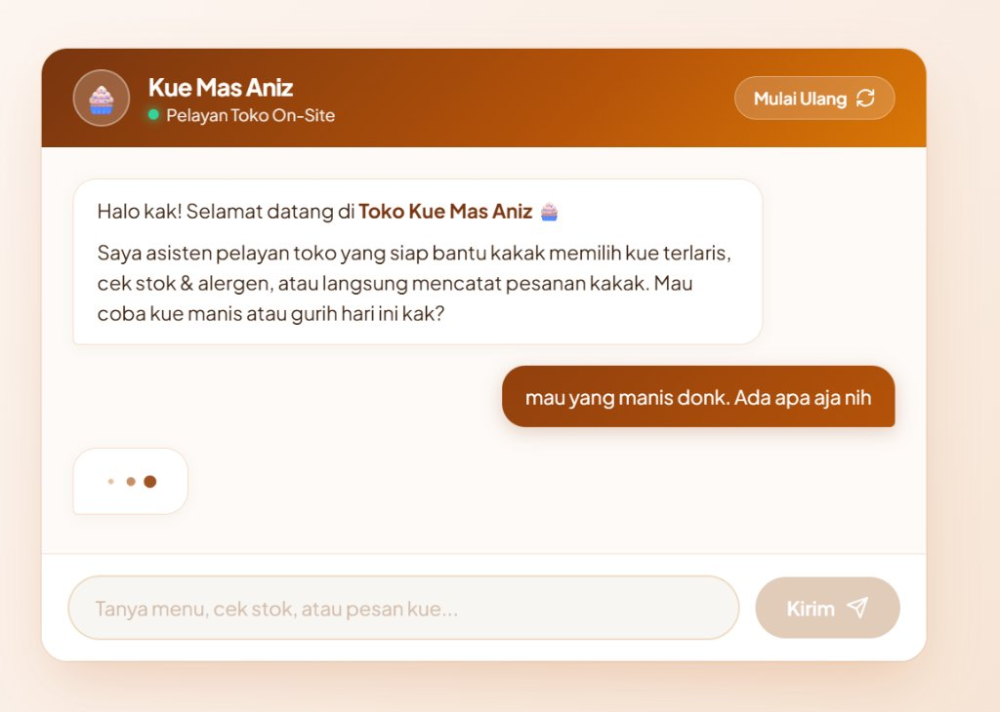

# 🧁 Kue Mas Aniz - Chatbot Pelayan Toko On-Site AI

Aplikasi chatbot web interaktif untuk asisten pelayan on-site toko roti dan kue **"Kue Mas Aniz"**. Dibangun menggunakan **Node.js (Express)**, **Google Gemini API (`@google/genai`)**, dan antarmuka **Vanilla JavaScript**.

Chatbot ini dilengkapi dengan **Function Calling (Tool Calling)** otomatis sehingga seluruh kalkulasi harga, ketersediaan stok, dan pengelolaan keranjang belanja pelanggan dihitung secara presisi oleh kode JavaScript tanpa halusinasi LLM.

---

## 📸 Tampilan Antarmuka (UI Preview)

<p align="center">
  
</p>

---

## ✨ Fitur Utama

- **Persona Pelayan Ramah**:
  - Menyapa pelanggan dengan sapaan hangat *"kak"*.
  - Gaya bicara sopan dan hangat dengan batas maksimal 1 emoji per pesan.
  - Menolak topik di luar kue dengan santun dan menjaga resep rahasia toko.
  - Menolak penawaran diskon secara halus sesuai kebijakan toko.
- **Function Calling & Deterministic Calculation**:
  - `cari_produk`: Mencari kue/paket berdasarkan kata kunci, kategori, atau harga maksimum.
  - `cek_stok`: Memeriksa ketersediaan stok produk dan paket secara akurat.
  - `info_alergen`: Memberikan informasi alergen resmi (misal telur, susu, gluten, santan).
  - `daftar_terlaris`: Menampilkan produk *best seller*.
  - `tambah_ke_keranjang`: Memvalidasi jumlah (1-20), memotong stok sesi aktif, dan menghitung subtotal.
  - `hapus_dari_keranjang`: Menghapus item dan mengembalikan stok sesi.
  - `lihat_keranjang` & `ringkas_pesanan`: Menampilkan rincian pesanan dan total harga sebelum pembayaran.
  - `kirim_ke_kasir`: Meneruskan pesanan ke kasir dengan kode unik berformat `KMA-XXXX`.
- **Aturan Sebutan Satuan (*No "pcs"*)**:
  - Tidak pernah menampilkan kata "pcs", melainkan sebutan asli kue: `potong`, `bungkus`, `buah`, atau `paket`.
- **Desain Modern *Warm Bakery Aesthetic***:
  - Tampilan visual hangat bernuansa cokelat kayu, karamel emas, dan krim.
  - Animasi *typing indicator* memantul saat bot sedang berpikir.
  - Rendering Markdown otomatis via `marked.js`.
  - Tombol **Mulai Ulang** untuk mengosongkan keranjang belanja dan memulai percakapan baru.

---

## 🛠️ Tech Stack

- **Backend**:
  - [Node.js](https://nodejs.org/) (ES Module)
  - [Express.js](https://expressjs.com/) (REST API & Static Web Server)
  - [@google/genai](https://www.npmjs.com/package/@google/genai) SDK Resmi (Gemini 3.5 Flash Lite & fallback Gemini 2.5 Flash)
  - `dotenv` (Environment Variables)
  - `cors`
- **Frontend**:
  - Vanilla HTML5 & CSS3 (Custom Responsive Flexbox, Glassmorphism, Bouncing Dots Animation)
  - Vanilla JavaScript (Fetch API, Session Storage, Markdown Parser via `marked.js`)
- **Data Source**:
  - `data/katalog.json` (Katalog produk & paket kue)

---

## 📁 Struktur Direktori

```text
gemini-chatbot-api/
├── assets/
│   └── ui-preview.jpg      # Cuplikan antarmuka aplikasi
├── data/
│   └── katalog.json        # Katalog data produk, harga, stok, alergen, dan paket
├── public/
│   ├── index.html          # Halaman antarmuka chat toko kue
│   ├── script.js           # Logika interaksi frontend & API fetch
│   └── style.css           # Desain tema warm bakery aesthetic & animasi
├── .env.example            # Template konfigurasi environment variable
├── .gitignore              # Daftar file/folder yang diabaikan git
├── index.js                # Server backend Express & integrasi Gemini Function Calling
├── package.json            # Manifest dependensi & scripts Node.js
├── README.md               # Dokumentasi proyek
└── tools.js                # Modul fungsi murni pengelolaan stok, katalog, dan keranjang
```

---

## 🚀 Panduan Instalasi & Menjalankan (Step-by-Step)

### 1. Prasyarat
Pastikan komputer Anda telah terinstal:
- **Node.js** versi 18.0.0 ke atas.
- **NPM** (bawaan Node.js).
- **Google Gemini API Key** (Dapatkan gratis di [Google AI Studio](https://aistudio.google.com/app/apikey)).

### 2. Clone Repositori
```bash
git clone https://github.com/kataanaz/gemini-chat-bot.git
cd gemini-chat-bot
```

### 3. Instal Dependensi
Jalankan perintah berikut untuk menginstal dependensi yang tertera di `package.json`:
```bash
npm install
```
> Atau install manual package yang digunakan:
> ```bash
> npm install express dotenv cors @google/genai
> ```

### 4. Konfigurasi Environment Variable
Salin file `.env.example` menjadi `.env`:
```bash
# Untuk Windows Command Prompt / PowerShell:
copy .env.example .env

# Atau untuk Linux / macOS / Git Bash:
cp .env.example .env
```
Buka file `.env` dan masukkan API Key Gemini Anda:
```env
GEMINI_API_KEY=masukkan_api_key_gemini_anda_di_sini
PORT=3000
```

> ⚠️ **PENTING**: Jangan pernah melakukan commit atau membagikan file `.env` ke publik!

### 5. Jalankan Server
```bash
node index.js
```
Jika berhasil, terminal akan menampilkan pesan:
```text
Server Toko Kue Mas Aniz siap di http://localhost:3000
```

### 6. Buka di Browser
Akses aplikasi melalui peramban:
👉 **[http://localhost:3000](http://localhost:3000)**

---

## 💬 Contoh Skenario Percakapan

| Pengguna | Bot Pelayan (Kue Mas Aniz) |
|---|---|
| *"Ada kue rasa cokelat apa saja ya?"* | Menampilkan daftar Brownies Panggang (Rp15.000/potong), Bolu Gulung (Rp12.000/potong), Pukis Cokelat (Rp15.000/bungkus), dll. |
| *"Brownies mengandung bahan apa saja? Ada susu?"* | Memeriksa data alergen dan menginformasikan kandungan telur, susu, dan gluten. |
| *"Saya pesan 2 brownies panggang dan 1 paket ngopi sore ya"* | Mengecek stok secara real-time, memasukkan ke keranjang belanja, dan menampilkan subtotal sementara. |
| *"Boleh minta diskon 30% kak?"* | Menolak secara sopan dengan menginformasikan bahwa diskon diadakan acak dan hari ini belum ada promo. |
| *"Saya mau bayar sekarang"* | Merangkum seluruh isi keranjang belanja, meminta konfirmasi akhir, lalu menerbitkan nomor pesanan (misal: `KMA-4921`) untuk dibawa ke kasir. |

---

## 🛡️ Keamanan & Praktik Terbaik

1. **API Key Terlindungi**: Kunci API hanya dipanggil di sisi server (backend Node.js), tidak pernah diekspos ke browser pelanggan.
2. **Whitelist Eksekusi Fungsi**: Menghindari penggunaan `eval()` atau `exec()`. Pemanggilan fungsi dari model Gemini diisolasi dalam daftar mapping yang telah divalidasi.
3. **Validasi Panjang Input**: Input pengguna dibatasi maksimal 500 karakter untuk mencegah spam dan eksploitasi prompt injection.
4. **Isolasi Sesi**: Keranjang belanja dan pengurangan stok dikelola per `sessionId` pelanggan.

---

## 📄 Lisensi
Proyek ini dibuat untuk tujuan pembelajaran dan pengembangan prototipe toko retail modern berbasis Artificial Intelligence.

